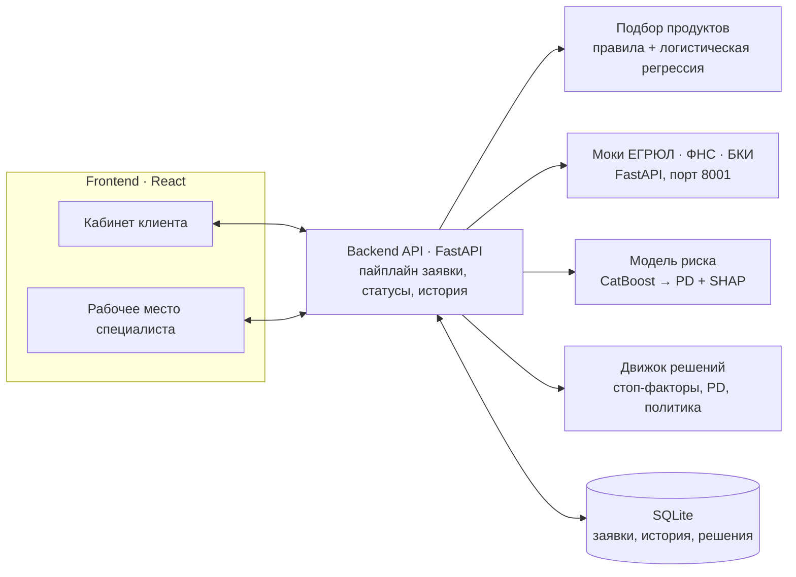

# Архитектура решения

## Умный кредитный кабинет предпринимателя

Цифровой кредитный конвейер для малого и микробизнеса. Хакатон «Альфа-Будущее», команда Cash Flow Crew.

## 1. Общая схема

Решение построено по клиент-серверной модели с отдельным ML-слоем. Компоненты взаимодействуют через REST API и запускаются в Docker-контейнерах одной командой `docker compose up --build`.



### 1.1. Технологический стек

| Слой | Технологии |
|---|---|
| Frontend | React 18, TypeScript, Vite, Tailwind CSS, Framer Motion |
| Backend | Python 3.11, FastAPI, SQLAlchemy, Uvicorn |
| База данных | SQLite (MVP) |
| ML-слой | CatBoost, scikit-learn, pandas |
| Моки интеграций | FastAPI-сервис, имитирующий ЕГРЮЛ, ФНС, БКИ |
| Инфраструктура | Docker, Docker Compose |

## 2. Компоненты

### 2.1. Frontend

Одностраничное приложение на React с двумя ролями:

- **Кабинет клиента:** калькулятор и подбор продуктов, форма заявки с автозаполнением по ИНН, трекер статусов, уведомления, подписание договора по коду.
- **Рабочее место специалиста:** список заявок с поиском и фильтром, карточка заявки с результатами проверок, PD и факторами риска, принятие решения с обязательным комментарием.

### 2.2. Backend (FastAPI)

- Создание, отправка и дозаполнение заявок.
- Фоновый конвейер обработки заявки (`BackgroundTasks`).
- Запросы к мокам внешних источников с таймаутом 3 секунды и одним повтором.
- Вызов подбора продуктов, модели риска и движка решений.
- Действия после одобрения: принятие предложения, подписание по коду (код проверяется на сервере), выдача.
- Раздельные представления заявки для клиента и сотрудника: клиенту не передаются PD, факторы риска и внутренние причины.

### 2.3. ML-слой

- **Подбор продуктов** (`scoring/recommender`): правила допуска по 6 продуктам Альфа-Банка (сумма, срок, возраст бизнеса, залог) и логистическая регрессия для ранжирования. Возвращает до трёх продуктов с метками «Лучший вариант / Тоже подходит / Альтернатива», причинами и платежом, а если ничего не подошло — подсказку, что изменить.
- **Модель риска** (`scoring/risk_model`): CatBoost, обученный на синтетических данных. Получает 15 признаков заявки и рассчитывает ещё 4 производных (долговая нагрузка, доля расходов, отношение кредита к выручке, покрытие залогом). Возвращает PD и топ-5 факторов с вкладом SHAP (рассчитывается средствами CatBoost).
- **Движок решений** (`scoring/decision`): правила кредитной политики поверх данных проверок, PD и платёжной нагрузки. Пороги вынесены в `scoring/decision/config.json`.

### 2.4. Моки внешних систем

Реальные интеграции заменены локальным FastAPI-сервисом на порту 8001 с синтетическими данными по ИНН (`mocks/data/seed.json`):

- `GET /egrul/{inn}` — регистрационные данные, статус компании, дата регистрации, отрасль;
- `GET /fns/{inn}` — налоговая задолженность, признаки недостоверности, массовый адрес;
- `GET /bki/{inn}?consent=true` — кредитная история, просрочки, запросы.

Ошибки: 404 — ИНН не найден, 403 — нет согласия на запрос в БКИ, 503 — источник недоступен. Задержка ответа задаётся переменной `MOCK_LATENCY_MS`. Для подключения реальных систем меняется только адрес `MOCKS_BASE_URL`.

## 3. Обработка заявки

Конвейер запускается при `POST /applications/{id}/submit`. Каждая смена статуса записывается в историю.

1. **Проверка данных (`checking`).** Запросы к ЕГРЮЛ, ФНС и БКИ. Если источник недоступен — `manual_review`.
2. **Обогащение.** Возраст бизнеса по дате регистрации, отрасль и форма бизнеса из ЕГРЮЛ, просрочки из БКИ.
3. **Оценка риска (`scoring`).** Модель рассчитывает PD и факторы риска. Для пяти демо-клиентов PD зафиксирован для воспроизводимости сценариев.
4. **Решение.** Движок применяет кредитную политику и переводит заявку в итоговый статус.
5. **После решения.** Сотрудник рассматривает заявки на ручном разборе. Клиент дополняет данные при `need_info` (`/supplement`) или проходит принятие → подписание → выдачу (`/accept`, `/sign`, `/disburse`).

### 3.1. Правила движка решений

Правила применяются по порядку, первое сработавшее определяет результат.

| Условие | Решение |
|---|---|
| Нет выручки, согласия на запрос в БКИ или компания не найдена | `need_info` |
| Ликвидация или банкротство, недостоверные сведения, просрочка более 90 дней | `rejected` (стоп-фактор) |
| PD не рассчитан | `manual_review` |
| PD ≥ 15% | `rejected` |
| Платёж больше 50% месячной выручки | Предложение меньшей суммы (`counter_offer`); если она ниже минимума продукта — `rejected` |
| Сумма больше 3 млн ₽, PD от 5% до 15% или мягкие сигналы риска (налоговый долг, просрочка 30–90 дней, более 5 запросов в БКИ за полгода, массовый адрес) | `manual_review` с рекомендацией системы |
| Остальные заявки | `approved` |

В каждом решении сохраняются `rules_version` и `model_version`.

## 4. Модель данных

Таблицы SQLite:

- `users` — клиенты и сотрудники;
- `applications` — параметры заявки, финансовые показатели, ответы внешних источников, PD, факторы риска, результат подбора и решение;
- `status_history` — история смены статусов: предыдущий и новый статус, кто изменил (клиент, система, сотрудник), время, комментарий.

Диаграмма статусов — в [credit_process.md](credit_process.md). Описание API — в Swagger (`http://localhost:8000/docs`) и в [openapi.json](openapi.json).

## 5. Надёжность и безопасность

- **Разделение данных:** отдельные API для клиента и сотрудника; клиент видит только понятные причины решения.
- **Аудит:** каждая смена статуса логируется с автором и комментарием; в решении сохраняются версии правил и модели.
- **Отказоустойчивость:** недоступный источник не роняет заявку — она уходит на ручную проверку.
- **Контроль переходов:** отправить заявку можно только из `draft` или `need_info`, решение сотрудника доступно только в статусах `checking`, `scoring`, `manual_review` и `need_info`, подписание — только после одобрения.

## 6. Развёртывание

```bash
docker compose up --build
```

| Сервис | Адрес |
|---|---|
| Веб-интерфейс | http://localhost:5173 |
| Backend API и Swagger | http://localhost:8000/docs |
| Моки внешних источников | http://localhost:8001/docs |
