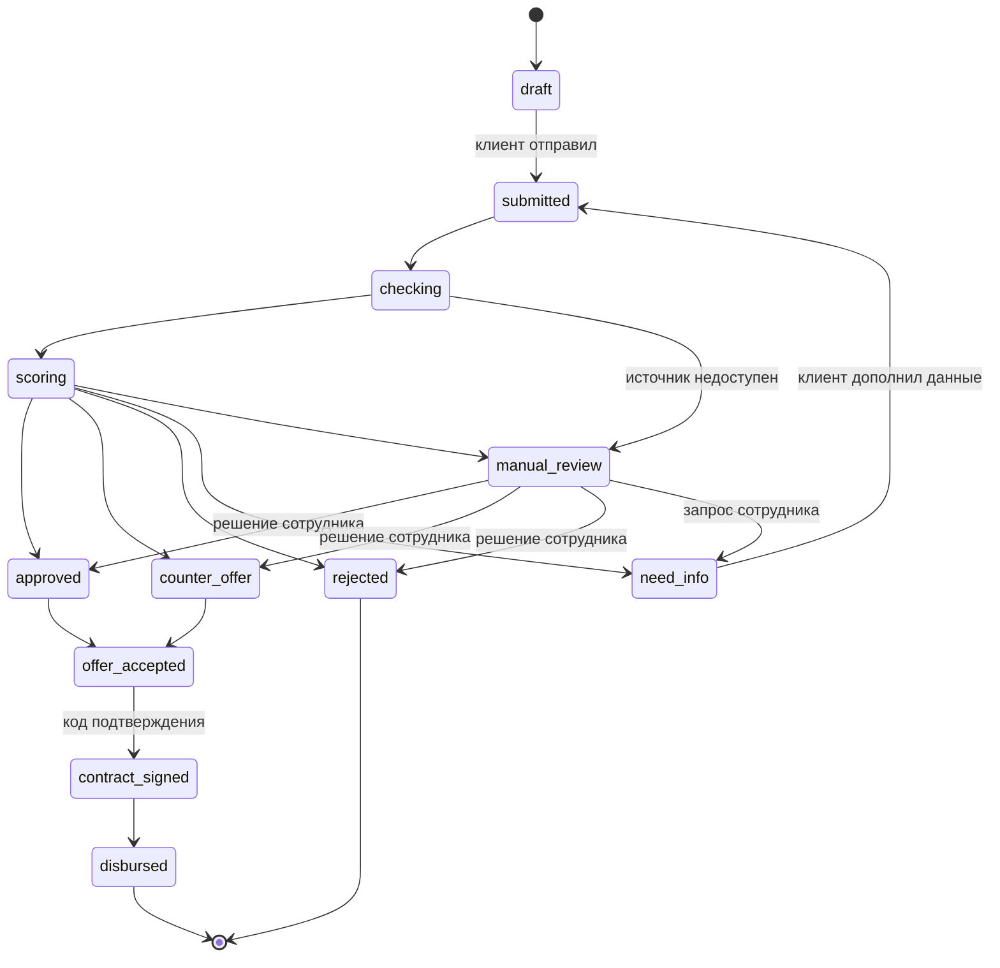

# Модель кредитного процесса

## Умный кредитный кабинет предпринимателя

**Направление:** бизнес-аналитика и моделирование кредитного процесса

---

## 1. Общая характеристика кредитного процесса

### 1.1. Назначение

Кредитный процесс представляет собой последовательность действий клиента, автоматизированной системы и сотрудника банка, направленных на рассмотрение заявки и принятие решения о предоставлении финансирования.

Основная задача решения — автоматизировать стандартные этапы кредитования малого и микробизнеса, обеспечить прозрачность рассмотрения и сохранить возможность экспертной проверки нестандартных обращений.

### 1.2. Цели автоматизации

Автоматизация кредитного процесса направлена на:

1. Сокращение времени обработки стандартных заявок.
2. Уменьшение объёма ручной работы сотрудников.
3. Повышение качества и полноты собираемых данных.
4. Обеспечение единых правил принятия решений.
5. Повышение прозрачности кредитного процесса для предпринимателя.
6. Снижение количества повторных действий при оформлении кредита.
7. Организацию контроля за движением кредитной заявки.

### 1.3. Границы процесса

**Начальная граница:** возникновение потребности бизнеса в финансировании и выбор параметров кредита.

**Основной процесс:** создание заявки, проверка данных, получение сведений из внешних источников, скоринговая оценка, применение кредитных правил и принятие решения.

**Конечная граница:** предоставление клиенту результата рассмотрения и дальнейших инструкций.

После одобрения предусматривается возможность подтверждения условий и демонстрационной выдачи кредита. Реальные денежные операции в рамках MVP не выполняются.

---

## 2. Участники кредитного процесса

В кредитном конвейере выделяются три основные роли.

### 2.1. Клиент

Клиентом является индивидуальный предприниматель или представитель организации, обращающийся за финансированием.

Основные действия клиента:

- Выбор цели кредитования.
- Определение суммы и срока кредита.
- Заполнение сведений о бизнесе.
- Предоставление финансовой информации.
- Подтверждение согласия на получение кредитной истории.
- Отправка заявки.
- Отслеживание статуса рассмотрения.
- Предоставление дополнительных сведений при необходимости.
- Ознакомление с предложенными условиями.

### 2.2. Автоматизированная система

Система отвечает за последовательное выполнение стандартных операций кредитного конвейера.

Основные функции:

- Создание и сохранение заявки.
- Проверка полноты и корректности информации.
- Получение данных из моделируемых внешних источников.
- Формирование признаков для скоринговой модели.
- Расчёт вероятности дефолта (PD).
- Анализ факторов кредитного риска.
- Проверка внутренних кредитных ограничений.
- Определение маршрута рассмотрения.
- Изменение статусов заявки.
- Сохранение истории обработки.
- Отображение результатов пользователю.

### 2.3. Сотрудник банка

Сотрудник участвует в рассмотрении заявок, для которых автоматического решения недостаточно.

Его функции:

- Просмотр заявок на ручной проверке.
- Анализ финансовых показателей клиента.
- Изучение информации из внешних источников.
- Анализ вероятности дефолта и факторов риска.
- Принятие решения об одобрении или отказе.
- Формирование альтернативного кредитного предложения.
- Запрос дополнительной информации.
- Добавление комментариев к принятому решению.

---

## 3. Этапы кредитного процесса

### 3.1. Определение потребности в финансировании

Кредитный процесс начинается с возникновения у предпринимателя потребности в дополнительных финансовых ресурсах.

Клиент определяет основную цель, необходимую сумму и предполагаемый срок кредитования.

**Результат этапа:** сформированы исходные параметры кредитного запроса.

### 3.2. Выбор кредитного продукта

На основании параметров запроса система может предложить подходящие кредитные продукты.

При подборе учитываются:

- Цель финансирования.
- Запрашиваемая сумма.
- Срок кредитования.
- Характеристики бизнеса.
- Наличие обеспечения.
- Ограничения кредитных продуктов.

**Результат этапа:** выбран подходящий вариант финансирования.

### 3.3. Создание кредитной заявки

Клиент заполняет электронную анкету.

Основные сведения:

- ИНН организации или предпринимателя.
- Организационно-правовая форма.
- Сфера деятельности.
- Возраст бизнеса.
- Запрашиваемая сумма.
- Срок кредитования.
- Цель финансирования.
- Годовая выручка.
- Ежемесячный оборот.
- Ежемесячные расходы.
- Действующие обязательства.
- Сведения о залоговом обеспечении.
- Информация о просрочках.

**Результат этапа:** сформирована и зарегистрирована кредитная заявка.

### 3.4. Проверка и обогащение данных

После отправки заявки запускается автоматизированная проверка информации.

Система обращается к моделируемым внешним источникам:

**ЕГРЮЛ/ЕГРИП** — для проверки существования бизнеса, его регистрационных данных, статуса и характеристик.

**ФНС** — для получения дополнительных сведений о компании, включая доступную информацию о задолженностях и признаках риска.

**БКИ** — для оценки кредитной истории, текущих обязательств и наличия просрочек.

Результаты проверок сохраняются в системе и могут использоваться на следующих этапах.

При недоступности внешних сервисов предусмотрена передача заявки на ручное рассмотрение.

В частности, при получении ошибки 503 от моделируемого сервиса БКИ заявка направляется сотруднику.

**Результат этапа:** сформирован набор сведений для оценки кредитоспособности либо определена необходимость ручной проверки.

### 3.5. Скоринговая оценка

После получения необходимых данных система переходит к оценке кредитного риска.

В проекте используется модель машинного обучения CatBoost, рассчитывающая вероятность дефолта за 12 месяцев.

Модель получает 15 признаков заявки и внешних источников:

| № | Признак | Назначение |
|---|---|---|
| 1 | Сумма кредита | Размер финансирования |
| 2 | Срок кредита | Продолжительность обязательства |
| 3 | Цель кредита | Назначение финансирования |
| 4 | Организационно-правовая форма | Характеристика заёмщика |
| 5 | Наличие залога | Наличие обеспечения |
| 6 | Тип залога | Характеристика обеспечения |
| 7 | Возраст бизнеса | Продолжительность деятельности |
| 8 | Годовая выручка | Финансовый масштаб компании |
| 9 | Ежемесячный оборот | Объём операций |
| 10 | Ежемесячные расходы | Финансовая нагрузка |
| 11 | Действующая задолженность | Кредитные обязательства |
| 12 | Ежемесячные платежи по долгам | Регулярная долговая нагрузка |
| 13 | Дни просрочки | Платёжная дисциплина |
| 14 | Стоимость залога | Размер обеспечения |
| 15 | Отрасль бизнеса | Отраслевая характеристика |

Дополнительно модель рассчитывает 4 производных признака: долговую нагрузку (платежи по долгам / оборот), долю расходов (расходы / оборот), отношение кредита к выручке и покрытие залогом (стоимость залога / сумма кредита). Всего модель использует 19 признаков.

Результатом работы модели является вероятность дефолта — PD.

Дополнительно формируются объяснения факторов риска с использованием SHAP.

Для пяти демонстрационных клиентов (сценарии 1–5) PD зафиксирован, чтобы сценарии воспроизводились одинаково. Для всех остальных заявок PD и факторы риска рассчитывает модель в реальном времени.

Если результат скоринга недоступен, заявка может быть передана на ручную проверку.

**Результат этапа:** получена оценка кредитного риска и информация о влияющих факторах.

---

## 4. Логика принятия кредитного решения

### 4.1. Общий принцип

Итоговое решение определяется сочетанием нескольких факторов:

- Полнота данных.
- Результаты внешних проверок.
- Вероятность дефолта.
- Запрашиваемая сумма.
- Финансовая нагрузка.
- Наличие критических ограничений.
- Дополнительные признаки риска.

Для применения правил используется Decision Engine.

### 4.2. Проверка полноты информации

Первоначально проверяется наличие обязательных сведений.

В частности:

- Годовой выручки.
- Согласия на получение кредитной истории.
- Данных о компании из регистрационного источника.

При недостаточности информации Decision Engine возвращает результат `need_info`.

Клиент получает сообщение о необходимости дополнить сведения.

Клиент дополняет данные в кабинете (`POST /applications/{id}/supplement`), после чего заявка повторно отправляется на рассмотрение.

### 4.3. Проверка критических ограничений

Критическими основаниями для отказа являются предусмотренные правилами стоп-факторы.

В реализованной логике к ним относятся:

- Нахождение компании в процессе ликвидации.
- Банкротство компании.
- Признак недостоверности регистрационных сведений.
- Просрочка по кредитам более 90 дней за последний год.

При обнаружении критического ограничения система формирует отказ.

### 4.4. Проверка вероятности дефолта

Для демонстрационной кредитной политики установлены два порога PD.

| Значение PD | Предварительная логика |
|---|---|
| PD ≤ 5% | Допускается автоматическое одобрение |
| 5% < PD < 15% | Ручное рассмотрение |
| PD ≥ 15% | Автоматический отказ |

Автоматическое одобрение возможно только при выполнении остальных условий.

### 4.5. Проверка платёжной нагрузки

Помимо кредитного риска система оценивает способность бизнеса обслуживать кредит.

Рассчитывается отношение действующих ежемесячных долговых платежей и нового кредитного платежа к среднемесячной выручке.

**Формула:**

PTI = (Текущие долговые платежи + Новый кредитный платёж) / Среднемесячная выручка.

Среднемесячная выручка рассчитывается делением годовой выручки на 12.

В демонстрационной конфигурации используется ограничение:

**PTI ≤ 50%.**

Если предполагаемый платёж превышает допустимую нагрузку, система рассчитывает доступную сумму финансирования.

Если уменьшенная сумма соответствует минимальным условиям продукта, может быть сформировано альтернативное предложение.

Если доступная сумма оказывается ниже минимальной суммы продукта, формируется отказ.

### 4.6. Порог обязательной ручной проверки

В системе установлен параметр:

`manual_review_amount = 3000000`

Если рассчитанная сумма кредитного предложения превышает 3 млн рублей, заявка направляется сотруднику для дополнительного рассмотрения.

Важно учитывать, что данное правило применяется после оценки платёжной нагрузки и возможного уменьшения суммы финансирования. Таким образом, крупная первоначальная заявка может получить иной маршрут, если система предварительно скорректировала условия.

### 4.7. Альтернативное кредитное предложение

Если запрошенная сумма создаёт чрезмерную платёжную нагрузку, система может рассчитать меньшую доступную сумму.

При отсутствии иных причин для ручной проверки формируется результат `counter_offer`.

Альтернативное предложение может содержать:

- Кредитный продукт.
- Скорректированную сумму.
- Срок кредитования.
- Расчётную процентную ставку.
- Ежемесячный платёж.

Сотрудник также может сформировать альтернативное предложение в ходе ручного рассмотрения.

---

## 5. Возможные результаты кредитного процесса

| Результат | Код | Основание |
|---|---|---|
| Одобрение | `approved` | Низкий риск, соблюдены ограничения |
| Ручной разбор | `manual_review` | Пограничный риск, сумма, дополнительные факторы или сбой источника |
| Отказ | `rejected` | Высокий риск, стоп-факторы или недопустимая платёжная нагрузка |
| Нужна информация | `need_info` | Недостаточно данных для решения |
| Альтернативное предложение | `counter_offer` | Возможность предложить другие условия |

### 5.1. Одобрение

Клиент получает положительный результат и рассчитанные условия финансирования.

### 5.2. Ручное рассмотрение

Заявка передаётся сотруднику банка.

Сотрудник анализирует информацию и может одобрить кредит, отказать, запросить дополнительные сведения или предложить другие условия.

### 5.3. Отказ

Клиент получает отрицательное решение.

Внутренние причины сохраняются для последующего анализа, а клиенту отображается предусмотренное системой объяснение.

### 5.4. Запрос информации

При недостатке необходимых сведений система предлагает дополнить заявку.

После внесения данных процесс может быть возобновлён.

### 5.5. Альтернативное предложение

Клиенту предоставляются изменённые условия финансирования, например уменьшенная сумма кредита.

Это позволяет учитывать финансовые возможности бизнеса и не ограничивать процесс исключительно одобрением или отказом.

---

## 6. Модель состояний заявки

### 6.1. Основные статусы

| Статус | Наименование | Описание |
|---|---|---|
| `draft` | Черновик | Заявка создана |
| `submitted` | Подана | Заявка отправлена клиентом |
| `checking` | Проверка данных | Выполняются внешние проверки |
| `scoring` | Скоринг | Рассчитывается риск |
| `approved` | Одобрена | Положительное решение |
| `rejected` | Отказ | Отрицательное решение |
| `manual_review` | Ручная проверка | Требуется участие сотрудника |
| `need_info` | Нужна информация | Необходимо дополнить данные |
| `counter_offer` | Альтернативное предложение | Предложены изменённые условия |
| `offer_accepted` | Предложение принято | Клиент принял условия |
| `contract_signed` | Договор подписан | Клиент подтвердил подписание кодом |
| `disbursed` | Кредит выдан | Демонстрационная выдача средств |

### 6.2. Диаграмма переходов

Недопустимые переходы запрещены на стороне backend: отправить заявку можно только из `draft` или `need_info`, решение сотрудника доступно только в статусах `checking`, `scoring`, `manual_review` и `need_info`, подписание — только после одобрения.

### 6.3. История изменения статусов

Для обеспечения прозрачности система сохраняет историю переходов заявки.

Запись истории содержит:

- Идентификатор заявки.
- Предыдущий статус.
- Новый статус.
- Участника, инициировавшего изменение.
- Время изменения.
- Комментарий.

Инициатором изменения может быть клиент, система или сотрудник банка.

История используется для отображения клиентского пути, анализа процесса и последующего контроля времени обработки заявок.

---

## 7. Обработка нестандартных ситуаций

### 7.1. Отсутствие обязательных данных

Если для принятия решения недостаточно информации, система формирует запрос на дополнение.

### 7.2. Недоступность внешних источников

При ошибках подключения к внешним источникам, в том числе при временной недоступности БКИ, заявка направляется на ручную проверку.

Такой подход позволяет сохранить управляемость процесса и избежать автоматического одобрения без необходимых данных.

### 7.3. Недоступность скоринговой модели

Если вероятность дефолта не удалось рассчитать, Decision Engine предусматривает ручное рассмотрение при отсутствии ранее выявленных оснований для другого решения.

### 7.4. Превышение допустимой платёжной нагрузки

При высокой платёжной нагрузке система проверяет возможность изменения суммы кредита.

Результатом может стать альтернативное предложение либо отказ, если доступная сумма не соответствует минимальным условиям продукта.

### 7.5. Наличие дополнительных факторов риска

При наличии факторов, которые не являются основанием для немедленного отказа, заявка может быть передана сотруднику.

Это позволяет использовать автоматическую оценку как поддержку принятия решения, не исключая экспертный анализ.

---

## 8. Основные данные кредитной заявки

Для хранения кредитных обращений используются следующие группы данных.

| Группа | Состав |
|---|---|
| Идентификация | ID заявки, ID клиента, ИНН, название компании |
| Параметры кредита | Продукт, сумма, срок, цель |
| Финансовые сведения | Выручка, обороты, расходы, задолженность, платежи |
| Характеристики бизнеса | Организационная форма, возраст, отрасль |
| Обеспечение | Наличие, тип и стоимость залога |
| Внешние проверки | Результаты ЕГРЮЛ, ФНС и БКИ |
| Скоринг | PD, факторы риска, версия модели |
| Решение | Результат, предложение, причины |
| Управление процессом | Статус, ответственный сотрудник, история изменений |

Хранение данных обеспечивает передачу информации между последовательными этапами кредитного процесса и позволяет избежать повторного получения уже доступных сведений.

---

## 9. Основные бизнес-правила

Для обеспечения последовательности обработки выделяются следующие бизнес-правила.

**BR-01.** Каждая новая заявка создаётся в статусе `draft`.

**BR-02.** После отправки заявка переходит в статус `submitted`, затем запускается автоматический кредитный конвейер.

**BR-03.** При недоступности необходимых внешних сервисов предусмотрена ручная проверка.

**BR-04.** Скоринговая модель определяет вероятность дефолта на основании характеристик заявки.

**BR-05.** При наличии критических стоп-факторов система отказывает в финансировании.

**BR-06.** При PD не менее 15% формируется автоматический отказ, если обработка дошла до оценки данного правила.

**BR-07.** При PD более 5%, но менее 15%, требуется ручная проверка.

**BR-08.** При рассчитанной сумме предложения более 3 млн рублей требуется ручная проверка.

**BR-09.** При превышении допустимой платёжной нагрузки система проверяет возможность уменьшения суммы финансирования.

**BR-10.** При наличии дополнительных некритических факторов риска заявка направляется на ручное рассмотрение.

**BR-11.** При отсутствии обязательных данных формируется результат `need_info`.

**BR-12.** Сотрудник может принять решение по заявке и зафиксировать комментарий.

**BR-13.** Изменение статуса сохраняется в истории заявки.

**BR-14.** Клиенту должен предоставляться понятный результат рассмотрения и информация о дальнейших действиях.

---

## 10. Критерии корректности процесса

Кредитный процесс считается корректно реализованным, если обеспечиваются следующие условия:

1. Заявка создаётся и сохраняется.
2. После отправки запускается обработка.
3. Данные проходят предусмотренные проверки.
4. Полученные сведения используются для оценки риска.
5. Скоринговая модель возвращает PD либо система корректно обрабатывает невозможность расчёта.
6. Кредитное решение соответствует установленным правилам.
7. Нестандартные заявки направляются на ручной разбор.
8. Клиент видит актуальный статус.
9. История изменения статусов сохраняется.
10. Сотрудник может выполнить предусмотренные действия.
11. После запроса дополнительных данных заявка может быть повторно отправлена.
12. Предложенные условия отображаются корректно.

Выполнение критериев подтверждено прогоном тестовых сценариев — см. [test_scenarios.md](test_scenarios.md).

---

## 11. Итоговый вывод

Разработанная модель кредитного процесса объединяет действия предпринимателя, автоматизированные проверки, скоринговую оценку и внутреннюю логику принятия решений в единую последовательность.

Использование модели CatBoost позволяет оценивать вероятность дефолта, а Decision Engine дополняет скоринг проверками кредитной политики, финансовой нагрузки и дополнительных факторов риска.

Важной особенностью решения является поддержка нескольких результатов рассмотрения: автоматического одобрения, отказа, ручной проверки, запроса дополнительных данных и альтернативного предложения.

Такая архитектура позволяет повысить уровень автоматизации стандартных обращений, сохраняя контроль над сложными и потенциально рискованными кредитными случаями.

Дальнейшее развитие процесса предполагает калибровку порогов на реальных данных (см. [анализ порогов PD](pd_threshold_analysis.md)), автоматический контроль SLA и расширение пользовательских сценариев.